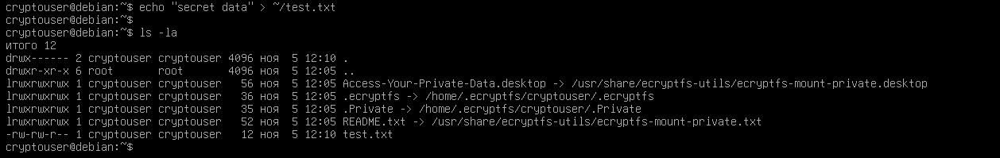
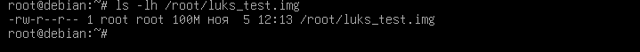
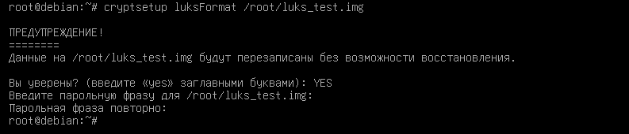
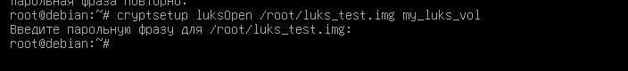
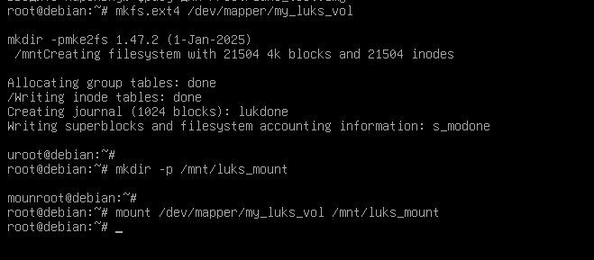
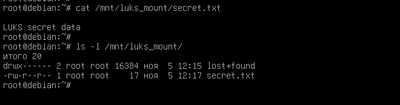
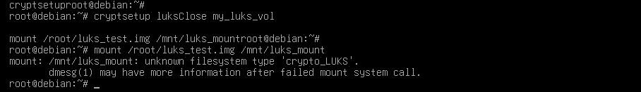

# Практическое задание с самопроверкой «Защита хоста»

## Задание 1
Установите eCryptfs.
Добавьте пользователя cryptouser.
Зашифруйте домашний каталог пользователя с помощью eCryptfs.
В качестве ответа пришлите снимки экрана домашнего каталога пользователя с исходными и зашифрованными данными.

## Задание 2
Установите поддержку LUKS.
Создайте небольшой раздел, например, 100 Мб.
Зашифруйте созданный раздел с помощью LUKS.
В качестве ответа пришлите снимки экрана с поэтапным выполнением задания.

Дополнительные задания (со звёздочкой)*
Эти задания дополнительные, то есть не обязательные к выполнению. Вы можете их выполнить, если хотите глубже шире разобраться в материале

## Задание 3*
Установите apparmor.
Повторите эксперимент, указанный в лекции.
Отключите (удалите) apparmor.
В качестве ответа пришлите снимки экрана с поэтапным выполнением задания.
